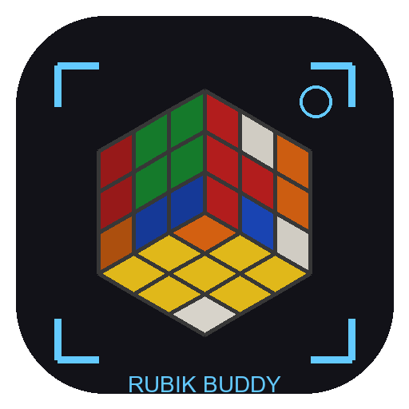
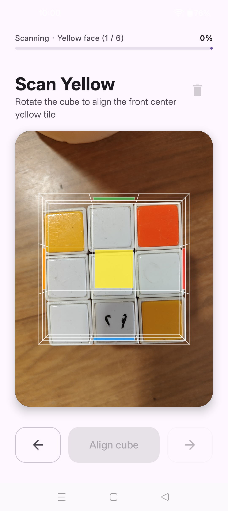
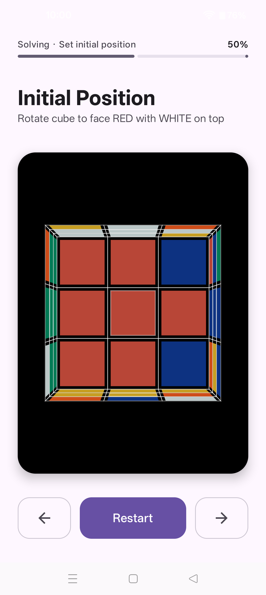
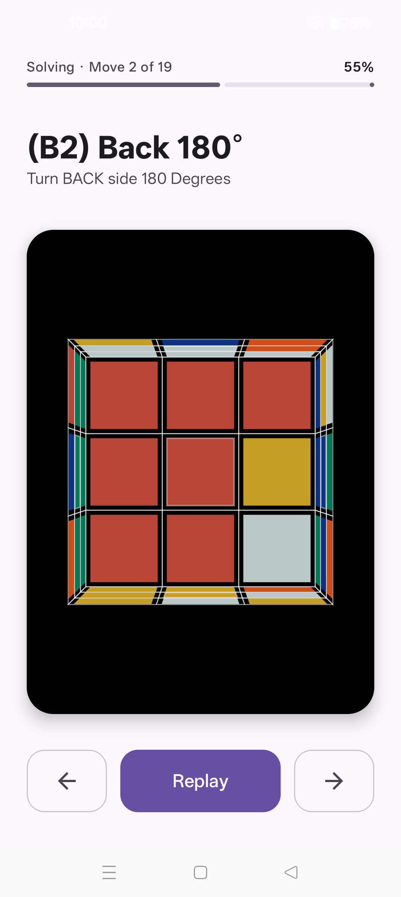
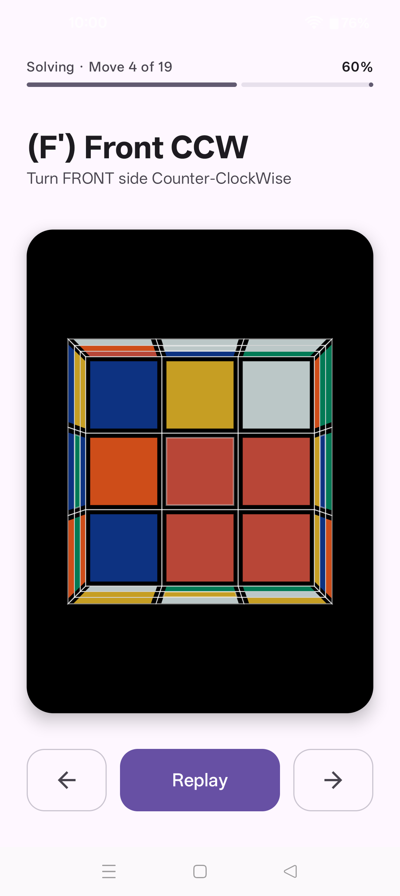

<p align="center"></p>

# Rubik Buddy

**Point your camera at a 3x3 Rubik's Cube and get a step-by-step solution.**

Rubik Buddy is an Android and iOS app that scans the six faces of a standard 3x3 cube with
the phone camera, lets you correct any misread tile, and then walks you through a short
solution with an animated 3D cube. Everything runs on the phone: there is no account,
no ads, no analytics, and no image ever leaves the device.

[Website](https://freevia.org/rubik-buddy/) ·
[Privacy policy](https://freevia.org/rubik-buddy/privacy) ·
[Support](.github/SUPPORT.md) ·
[Security](SECURITY.md)

**Google Play — Android:** [Join the internal test with an invited Google account](https://play.google.com/apps/internaltest/4701679095877744035).
Android 0.1.0 (build 69) is available to invited testers with Android 9+
and a camera. The production release is in Google review; the
[public Play listing](https://play.google.com/store/apps/details?id=org.freevia.rubikbuddy)
may not open until approval. No GitHub APK release has been published.

**iOS 1.0.0:** prepared for App Store signing and physical-device acceptance.
See the [App Store submission kit](app-store/README.md). It is not yet available
on the App Store or TestFlight.

## Screenshots

Real screens from an Android phone with a real cube.

<p>
  
  
  
  
</p>

## Features

- Guided scan of all six faces, one rotation at a time.
- Tap any tile to fix a color the camera got wrong; the cube is validated before solving.
- Near-optimal solutions from the Kociemba two-phase algorithm (min2phase), computed offline.
- Step-by-step instructions with an animated, draggable 3D cube.
- Works offline. Only the `CAMERA` permission is requested.

## How scanning works

Frames from CameraX (Android) or AVFoundation (iOS) are analysed on the device by the `rubik-vision` module:

1. The nine sticker regions of the face in the viewfinder are sampled and converted to CIE Lab.
2. The six centre stickers establish the white balance and the reference hue of each colour
   for the current lighting.
3. Every other sticker is classified by hue angle (`atan2(b, a)`) against those references,
   which keeps orange/red and yellow apart even when brightness or saturation varies. White
   has no useful hue, so a tile is white when it has very low chroma, or is light with only a
   mild colour cast (this stops white tiles under tinted light being read as blue).
4. The assembled 54-sticker state is checked by `rubik-model` for impossible cubes (wrong
   colour counts, twisted corners, parity) before it is handed to the solver.

The design notes behind these choices are kept in [`docs/history`](docs/history).

## Project layout

| Module | Purpose |
| --- | --- |
| `composeApp` | Shared scan/solve UI and app state, with Android and iOS camera adapters |
| `rubik-model` | Cube state, moves and validation (Kotlin Multiplatform, pure Kotlin) |
| `rubik-vision` | Colour classification and the face-scan flow |
| `rubik-solver` | Solver wrapper: Java min2phase on Android, `min2phaseCXX` (git submodule) on iOS |
| `iosApp` | iOS host (simulator tested; not published) |

## Build

For the iOS host, see [iOS build preparation](docs/IOS_BUILD.md).

Requirements: JDK 21 and the Android SDK with platform 36.

```bash
git clone --recurse-submodules https://github.com/freevia-org/rubik-buddy.git
cd rubik-buddy
./gradlew :composeApp:assembleDebug     # debug APK
./gradlew :rubik-model:jvmTest :rubik-vision:testAndroidHostTest :rubik-solver:testAndroidHostTest
./gradlew :composeApp:bundleRelease     # Play bundle (AAB), unsigned unless signing is configured
```

On Windows use `.\gradlew.bat`. Nothing secret is needed to build. Optional extras:

- **Release signing:** set `SIGNING_KEYSTORE`, `SIGNING_KEYSTORE_PASSWORD`,
  `SIGNING_KEY_ALIAS` and `SIGNING_KEY_PASSWORD` (environment variables, or the Gradle
  properties `signing.keystore`, `signing.keystorePassword`, `signing.keyAlias`,
  `signing.keyPassword`). Without them the release build is unsigned.
- **Firebase App Distribution (developer upload only):** copy
  `composeApp/google-services.json.example` to `composeApp/google-services.json`
  (git-ignored) with your own project values and point `FIREBASE_CREDENTIALS_FILE` at your
  service-account key outside the repository. The shipped app contains no Firebase SDK.

## Contributing

Issues and pull requests are welcome; see [CONTRIBUTING.md](CONTRIBUTING.md). Issues are
public, so please keep reports free of personal photos or information.

## License

Rubik Buddy is released under the [MIT License](LICENSE). Third-party components keep their
own licences; see [NOTICE](NOTICE).

App Store publishing preparation: [submission kit](app-store/README.md).
